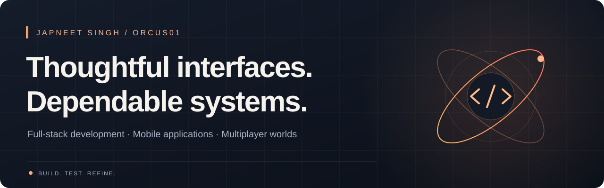

  <a href="https://orcus01.github.io/Portfolio/"><b>Portfolio ↗</b></a> &nbsp; / &nbsp;
  <a href="https://www.linkedin.com/in/japneet--singh/"><b>LinkedIn ↗</b></a> &nbsp; / &nbsp;
  <a href="mailto:japneet.singh2024@gmail.com"><b>Get in touch ↗</b></a>

### Hi, I'm Japneet.

I build across the stack: Java and Spring Boot services, web interfaces, Flutter applications, and browser-based multiplayer games. I care about the details that make software useful—clear interactions, reliable state, and tests that catch real problems.

### In the spotlight · OrcusDash

**Grab a weapon. Cause chaos. Take the crown.** A 3D browser kart battler with eight arenas, three modes, bots, private rooms, and keyboard + touch controls. Built with TypeScript, Three.js, Rapier, and a WebSocket game server.

[**Play the game →**](https://orcusdash.orcus-pro01.chatgpt.site) &nbsp; [Explore the source](https://github.com/Orcus01/OrcusDash)

### Selected work

| Project | What I built | Explore |
| :--- | :--- | :--- |
| **Kissan Konnect** | A Flutter plant-health application with camera-based diagnosis workflows, weather information, and Firebase integration. | [Source →](https://github.com/Orcus01/Kissan_Konnect) |
| **Raahi** | A web platform for students to share interview experiences and find placement guidance. React, Node.js, Express, and MongoDB. | [Source →](https://github.com/Orcus01/Raahi) |
| **Portfolio** | A responsive project showcase with case studies, interactive details, and persistent themes. React + Vite. | [Visit →](https://orcus01.github.io/Portfolio/) · [Source](https://github.com/Orcus01/Portfolio) |
| **Seats & Spaces** | A public React furniture storefront, separate from the private full-stack commerce implementation. | [Source →](https://github.com/Orcus01/seats-spaces) |

### My toolkit

**Backend & data** &nbsp; Java · Spring Boot · Spring Cloud · Node.js · MySQL · MongoDB  
**Web & mobile** &nbsp; TypeScript · React · Next.js · Angular · Flutter · Dart  
**Quality & delivery** &nbsp; JUnit · Playwright · Vitest · GitHub Actions · Docker  
**Interactive 3D** &nbsp; Three.js · Rapier · WebSockets

---

<b>Explore a project. Try a build. Let's talk about what comes next.</b> <a href="https://orcus01.github.io/Portfolio/">orcus01.github.io/Portfolio</a>

